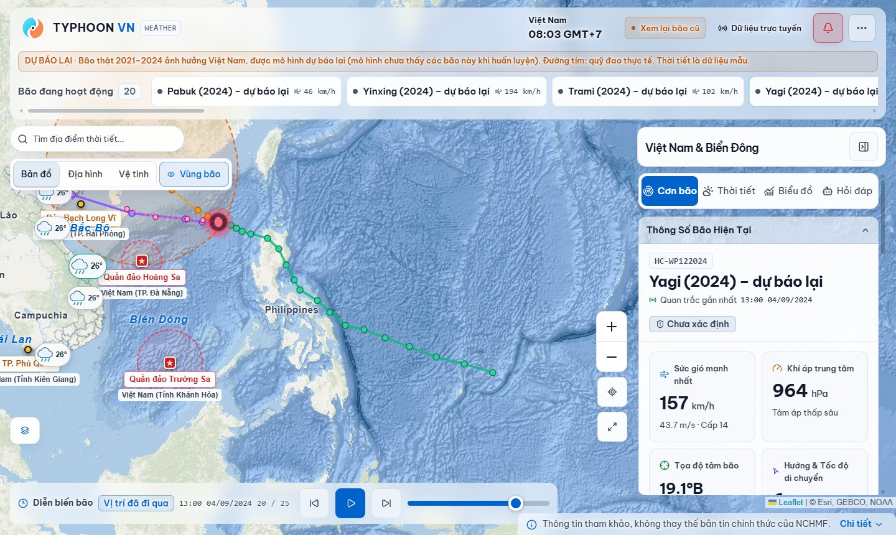
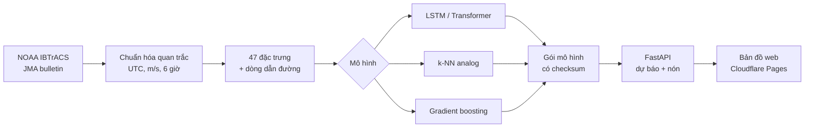

<div align="center">

# 🌀 Typhoon VN

### Xây dựng hệ thống hỗ trợ gợi ý đường đi của cơn bão ảnh hưởng Việt Nam

Dự báo vị trí tâm bão **+6 → +72 giờ**, kèm **nón bất định** và **các cơn bão lịch sử tương tự** để giải thích vì sao hệ thống gợi ý đường đi đó.

[](https://baoviet2026.pages.dev)




</div>

> [!WARNING]
> **Chỉ hỗ trợ ra quyết định, phục vụ học tập và nghiên cứu.** Không thay thế bản tin của Trung tâm Dự báo Khí tượng Thủy văn Quốc gia (NCHMF).
> Forecasts are decision support only, not official weather warnings.

---

## 🎯 Bài toán

Một cơn bão không "chọn" đường đi, nên **gợi ý đường đi** ở đây là **dự báo chuỗi thời gian nhiều bước**: ước lượng vị trí tâm bão tương lai và độ bất định của nó.

| | |
|---|---|
| **Đầu vào** | 4 quan trắc gần nhất, cách nhau 6 giờ (24 giờ lịch sử), mỗi quan trắc có 47 đặc trưng: vị trí, vận tốc, hướng, gia tốc, khoảng cách tới bờ biển Việt Nam, Hoàng Sa, Trường Sa, mùa và cường độ |
| **Đầu ra** | Vị trí tâm bão tại **+6, +12, +24, +48, +72 giờ**, dưới dạng độ dịch chuyển so với vị trí cuối |
| **Dữ liệu** | NOAA IBTrACS v04r01, Tây Bắc Thái Bình Dương 1980–2024: **1.089 cơn bão, 24.024 quan trắc** |
| **Chia tập** | Theo năm, giữ nguyên cả cơn bão, không rò rỉ: train ≤ 2016, validation 2017–2020, test 2021–2024 |
| **Độ đo** | Sai số khoảng cách vòng lớn (km) và độ phủ của nón bất định |

## 📊 Kết quả chính

Sai số trung bình (km) trên tập test 2021–2024, chưa từng dùng khi huấn luyện hay chọn mô hình:

| Phương pháp | 6h | 12h | 24h | 48h | 72h |
|---|---:|---:|---:|---:|---:|
| Persistence (giữ nguyên vận tốc) | 31 | 68 | 155 | 390 | 676 |
| k-NN analog (bão tương tự) | 32 | 64 | 133 | 290 | 462 |
| Gradient boosting | 29 | 60 | 129 | 292 | 476 |
| LSTM | 33 | 65 | 133 | 289 | 464 |
| Transformer | 33 | 64 | 133 | 293 | 468 |
| **Ensemble LSTM + Transformer + dòng dẫn đường** ¹ | **28** | **54** | **112** | **259** | **443** |

¹ Trên các cửa sổ của bão vùng Việt Nam, có thêm 11 đặc trưng dòng dẫn đường khí quyển (NCEP/NCAR R1).

- 📉 So với persistence, mọi phương pháp học **giảm 170–200 km sai số ở 72 giờ**, có ý nghĩa thống kê (bootstrap theo cơn bão, KTC 95% không chứa 0).
- 🌬️ Thêm **dòng dẫn đường khí quyển** cải thiện có ý nghĩa: **−35 km ở 72 giờ**, KTC 95% [−62, −9].
- 🔍 **k-NN analog** chính xác ngang mạng sâu nhưng **giải thích được**: mỗi gợi ý kèm 5 cơn bão lịch sử giống nhất (ví dụ YAGI 2024 → WUKONG 2000, DAMREY 2005).
- 🎯 Nón bất định 80% đạt độ phủ thực tế **82–86%** ở mọi mốc thời gian.

Chi tiết, kiểm định thống kê và các ca YAGI, SAOLA, YINXING: [báo cáo đánh giá](docs/report/README.md).

## ⚙️ Cách hệ thống hoạt động



| Tầng | Công nghệ | Mã nguồn |
|---|---|---|
| Thu thập, làm sạch dữ liệu | Python, pandas | [`src/typhoon_vn/ingestion`](src/typhoon_vn/ingestion) |
| Đặc trưng và tập dữ liệu | NumPy, scaler chỉ fit trên train | [`features`](src/typhoon_vn/features), [`datasets`](src/typhoon_vn/datasets) |
| Mô hình và huấn luyện | PyTorch, scikit-learn | [`models`](src/typhoon_vn/models), [`training`](src/typhoon_vn/training) |
| Suy luận và nón bất định | Gói mô hình kiểm tra mã băm và schema | [`src/typhoon_vn/inference`](src/typhoon_vn/inference) |
| API | FastAPI, khóa API, giới hạn tần suất | [`src/typhoon_vn/api`](src/typhoon_vn/api) |
| Bản đồ web | React, Vite, Leaflet, Cloudflare Pages Functions | [`viz/frontend`](viz/frontend) |

## 🗺️ Tính năng của bản đồ web

**Demo:** <https://baoviet2026.pages.dev>

- 🌀 **Bão đang hoạt động** lấy trực tiếp từ bản tin JMA, kèm quỹ đạo, nón bất định và thanh thời gian để tua diễn biến.
- ⏪ **Dự báo lại 20 cơn bão thật 2021–2024** ảnh hưởng Việt Nam (nút "Dự báo lại"): đường dự báo đặt cạnh quỹ đạo thực tế để thấy sai số.
- 🟣 **Gợi ý theo bão tương tự:** đường đi gợi ý của k-NN analog và danh sách bão lịch sử giống nhất.
- 📍 **Ảnh hưởng theo tỉnh:** tỉnh nào nằm trong nón và gần tâm bão nhất.
- 🌦️ **Thời tiết** tại các điểm trên bản đồ (Open-Meteo), có Hoàng Sa và Trường Sa.
- 💬 **Trợ lý hỏi đáp AI** về cơn bão đang xem.

## 🚀 Cài đặt và chạy

**Yêu cầu:** Python 3.11, Node.js 22.18+ (cho bản đồ web).

```powershell
# 1. Môi trường Python
py -3.11 -m venv .venv
.\.venv\Scripts\Activate.ps1
python -m pip install -e ".[api,train,ingestion,dev]"

# 2. Kiểm thử
python -m pytest -q

# 3. Chạy API, rồi mở http://127.0.0.1:8000/docs
python -m uvicorn typhoon_vn.api.app:app --reload
```

<details>
<summary><b>Huấn luyện và tái lập kết quả</b></summary>

```powershell
python -m typhoon_vn.cli --help
python -m typhoon_vn.cli train --help
python -m typhoon_vn.cli train --config configs/phase3_lstm.yaml --output-dir runs/phase3-lstm

# Tái lập bảng kết quả trong báo cáo
python scripts/run_ibtracs_benchmark.py --data-root data --output-dir runs/ibtracs-benchmark
python scripts/run_model_comparison.py --data-root data --output-dir runs/model-comparison --seeds 0 1 2
python scripts/plot_error_analysis.py --run runs/model-comparison --data-root data
```

Lần chạy trên dữ liệu tổng hợp được gắn nhãn `synthetic-demo`. Đó không phải số liệu trên bão thật. Đọc [hướng dẫn nạp dữ liệu](docs/data-ingestion.md) trước khi tải nguồn.

</details>

<details>
<summary><b>Bản đồ web (frontend)</b></summary>

```powershell
cd viz/frontend
npm install
npm run dev     # máy chủ phát triển
npm test        # kiểm thử Pages Functions
```

Xem thêm [tài liệu frontend](docs/frontend.md).

</details>

<details>
<summary><b>Worker cập nhật bão đang hoạt động</b></summary>

```powershell
python -m typhoon_vn.cli worker --ibtracs-active --once
```

IBTrACS ACTIVE chỉ cập nhật vài lần mỗi tuần, nên vị trí có thể trễ vài ngày. Đây không phải nguồn bản tin vận hành.

</details>

## 📁 Cấu trúc thư mục

```text
typhoon-track-vietnam/
├── src/typhoon_vn/      # Gói Python: ingestion → features → models → training → inference → api
│   └── dashboard/       # Bản build của bản đồ web (được Cloudflare Pages phục vụ)
├── viz/frontend/        # Mã nguồn bản đồ web React + Cloudflare Pages Functions
├── tests/               # Bộ kiểm thử pytest
├── scripts/             # Benchmark, so sánh mô hình, vẽ biểu đồ, tải dữ liệu
├── configs/             # Cấu hình huấn luyện (YAML)
├── docs/                # Báo cáo, kiến trúc, hợp đồng dữ liệu, nhật ký quá trình
├── baocao/              # Báo cáo đồ án (LaTeX + PDF) và slide trình bày
├── infra/               # Dockerfile, lịch chạy worker
├── data/ checkpoints/   # Chỗ để dữ liệu và mô hình (không đưa lên git)
└── pyproject.toml       # Khai báo gói và phụ thuộc
```

## 📚 Tài liệu

| Nội dung | Vị trí |
|---|---|
| 📄 Báo cáo đồ án (PDF) | [`baocao/Bao-cao-do-an-TTNT-Typhoon-VN.pdf`](baocao/Bao-cao-do-an-TTNT-Typhoon-VN.pdf) |
| 📊 Báo cáo đánh giá mô hình | [`docs/report/README.md`](docs/report/README.md) |
| 🎤 Slide trình bày (PDF) | [`baocao/Slide-do-an-TTNT-Typhoon-VN.pdf`](baocao/Slide-do-an-TTNT-Typhoon-VN.pdf) · [mã nguồn Beamer](baocao/slide-typhoon-vn/slide.tex) |
| 🧭 Hướng dẫn bảo vệ (demo 5 phút, Q&A) | [`docs/acceptance/HUONG_DAN_BAO_VE.md`](docs/acceptance/HUONG_DAN_BAO_VE.md) |
| ✅ Hồ sơ nghiệm thu 28 tiêu chí | [`docs/acceptance/README.md`](docs/acceptance/README.md) |
| 🏗️ Kiến trúc hệ thống | [`docs/architecture.md`](docs/architecture.md) |
| 📐 Hợp đồng dữ liệu | [quan trắc](docs/contracts/observations.md) · [đặc trưng](docs/contracts/features.md) · [gói mô hình](docs/contracts/model-bundle.md) |
| 🔬 Benchmark IBTrACS | [`docs/planning/evidence/B01-ibtracs-benchmark.md`](docs/planning/evidence/B01-ibtracs-benchmark.md) |
| 🤝 Đóng góp | [`CONTRIBUTING.md`](CONTRIBUTING.md) · [quy trình nhánh](docs/branching.md) |

## ⚠️ Hạn chế

- Mô hình đang phục vụ trên web là **LSTM chỉ dùng quỹ đạo**. Mô hình có dòng dẫn đường chính xác hơn nhưng cần dữ liệu khí quyển tại thời điểm dự báo (ví dụ GFS) mới đưa vào vận hành được.
- Nón bất định là hình tròn. Thực tế sai số dọc quỹ đạo và ngang quỹ đạo khác nhau.
- Có ca khó chưa giải được: YAGI 2024 vẫn bị dự báo đổi hướng tây bắc (sai khoảng 620 km ở 72 giờ).
- Hệ thống **chưa sẵn sàng vận hành thực tế** (not production-ready). Các khoảng trống vận hành được ghi trong [R14](docs/planning/evidence/R14-operational-gaps.md).

## 📜 Giấy phép

Phát hành theo [giấy phép MIT](LICENSE).
