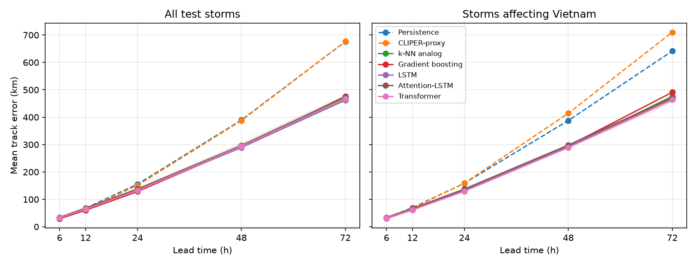
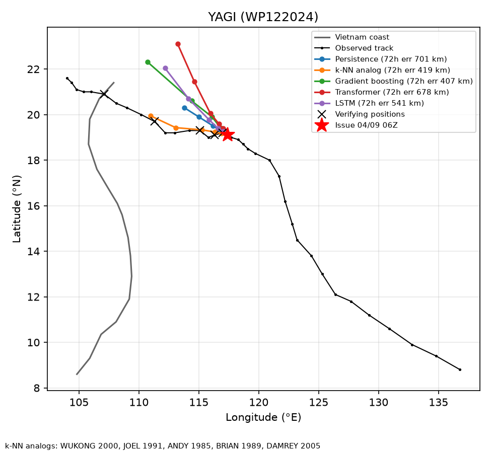

# Xây dựng hệ thống hỗ trợ gợi ý đường đi của cơn bão ảnh hưởng Việt Nam

Báo cáo môn Trí tuệ nhân tạo (bản nháp, số liệu sinh từ mã nguồn trong repo).

> Hệ thống chỉ hỗ trợ ra quyết định, phục vụ học tập/nghiên cứu. Không thay thế
> bản tin của Trung tâm Dự báo Khí tượng Thủy văn Quốc gia (NCHMF).

## 1. Phát biểu bài toán

"Gợi ý đường đi của cơn bão" được mô hình hóa là **bài toán dự báo chuỗi thời
gian nhiều bước** (multi-horizon regression), không phải bài toán tìm đường: cơn
bão không "chọn" đường đi, nên mục tiêu là ước lượng vị trí tâm bão tương lai và
độ bất định của nó.

- **Đầu vào:** 4 quan trắc gần nhất, cách nhau 6 giờ (24 giờ lịch sử). Mỗi
  quan trắc có 47 đặc trưng: vị trí, độ trễ (lag), vận tốc, hướng di chuyển,
  gia tốc, góc đổi hướng, khoảng cách tới bờ biển Việt Nam và các điểm tham chiếu
  (Hoàng Sa, Trường Sa, Đà Nẵng, …), mã hóa chu kỳ giờ/ngày/tháng, cường độ.
- **Đầu ra:** vị trí tâm bão tại +6, +12, +24, +48, +72 giờ.
- **Cách biểu diễn đầu ra:** dự báo **độ dịch chuyển** so với vị trí cuối thay vì
  tọa độ tuyệt đối (xem mục 5.2).
- **Hàm mất mát:** Smooth L1 trên độ dịch chuyển (độ).
- **Độ đo:** sai số khoảng cách vòng lớn (great-circle, km) giữa vị trí dự báo
  và vị trí thực; độ phủ (coverage) của nón bất định.

## 2. Dữ liệu

- **Nguồn:** NOAA IBTrACS v04r01, lưu vực Tây Bắc Thái Bình Dương (WP), 1980–2024.
- **Làm sạch:** chuẩn hóa đơn vị (knot → m/s), khử trùng lặp, chỉ giữ quan
  trắc synop 6 giờ, giới hạn vùng 0–30°N, 100–140°E (vùng liên quan Việt Nam).
  Còn 24.024 quan trắc, 1.089 cơn bão.
- **Chia tập không rò rỉ:** chia **theo năm, giữ nguyên cả cơn bão**:
  train 895 bão (đến 2016), validation 110 bão (2017–2020), test 84 bão
  (2021–2024). Bộ chuẩn hóa (scaler) chỉ fit trên train.
- **Tập con "bão ảnh hưởng Việt Nam":** bão trong tập test có quỹ đạo đi vào
  trong 300 km tính từ đường bờ biển Việt Nam: 27 bão, 278 cửa sổ dự báo.

## 3. Các phương pháp

| Nhóm | Phương pháp | Ý tưởng |
|---|---|---|
| Mốc so sánh | Persistence | Giữ nguyên vận tốc 6 giờ gần nhất |
| Mốc so sánh | CLIPER-proxy | Persistence có suy giảm (không phải CLIPER5 chính thức) |
| AI cổ điển | **k-NN analog** (lập luận dựa trên tình huống) | Tìm các tình huống bão lịch sử giống nhất (đoạn quỹ đạo, vị trí, mùa) và lấy trung bình có trọng số đường đi tiếp theo của chúng; **nêu tên các cơn bão tương tự** để giải thích gợi ý |
| Học máy cổ điển | Gradient boosting | Cây tăng cường (HistGradientBoosting) hồi quy độ dịch chuyển từ cửa sổ đặc trưng |
| Học sâu | LSTM | Mạng hồi quy đọc 4 bước, đầu ra 5 mốc |
| Học sâu | Attention-LSTM | LSTM + attention cộng trên chuỗi đầu vào |
| Học sâu | Transformer | Encoder self-attention + mã hóa vị trí |

- Siêu tham số k-NN chọn trên **validation**: k = 40, trọng số vị trí 1.0,
  mùa 0.5.
- Mạng nơ-ron: Adam, lr 1e-3, cosine schedule, early stopping (patience 10),
  lấy trọng số epoch tốt nhất trên validation.
- Seq2Seq có trong mã nguồn nhưng không đưa vào so sánh: cơ chế teacher forcing
  trộn tọa độ đã chuẩn hóa với mục tiêu vật lý nên chưa bọc dự báo độ dịch
  chuyển một cách đúng đắn.

## 4. Kết quả

Phương pháp học được chạy 3 seed (trung bình ± độ lệch chuẩn); persistence,
CLIPER và k-NN là tất định. Chi tiết: [comparison.md](comparison.md).

### 4.1 Sai số trung bình (km), toàn bộ 84 bão test

| Phương pháp | 6h | 12h | 24h | 48h | 72h |
|---|---:|---:|---:|---:|---:|
| Persistence | 31 | 68 | 155 | 390 | 676 |
| CLIPER-proxy | 30 | 65 | 151 | 388 | 677 |
| k-NN analog | 32 | 64 | 133 | 290 | 462 |
| Gradient boosting | 29 | 60 | 129 | 292 | 476 |
| LSTM | 33 ± 0 | 65 ± 1 | 133 ± 1 | 289 ± 1 | 464 ± 5 |
| Attention-LSTM | 35 ± 3 | 68 ± 4 | 138 ± 5 | 297 ± 10 | 473 ± 9 |
| Transformer | 33 ± 1 | 64 ± 1 | 133 ± 3 | 293 ± 3 | 468 ± 5 |

### 4.2 Sai số trung bình (km), 27 bão ảnh hưởng Việt Nam

| Phương pháp | 6h | 12h | 24h | 48h | 72h |
|---|---:|---:|---:|---:|---:|
| Persistence | 33 | 70 | 159 | 388 | 642 |
| CLIPER-proxy | 32 | 68 | 159 | 414 | 710 |
| k-NN analog | 33 | 65 | 134 | 290 | 476 |
| Gradient boosting | 30 | 61 | 131 | 295 | 491 |
| LSTM | 32 ± 0 | 63 ± 0 | 133 ± 1 | 292 ± 6 | 468 ± 9 |
| Attention-LSTM | 34 ± 3 | 66 ± 4 | 138 ± 4 | 298 ± 6 | 471 ± 3 |
| Transformer | 32 ± 1 | 62 ± 1 | 130 ± 2 | 289 ± 3 | 463 ± 10 |



### 4.3 Kiểm định thống kê (bootstrap theo cơn bão, 72 h)

Các dự báo của cùng một cơn bão tương quan với nhau, nên lấy mẫu lại theo **cơn
bão** (50 bão test có dự báo 72 h, 5.000 lần). Chi tiết:
[significance.md](significance.md).

- So với persistence, mọi phương pháp học đều tốt hơn **170–200 km**, khoảng
  tin cậy 95% không chứa 0 (có ý nghĩa thống kê).
- So với LSTM: k-NN (+3 km, KTC [−29, +34]), gradient boosting (+12, [−20, +48]),
  Transformer (+3, [−16, +22]) **không khác biệt có ý nghĩa**; Attention-LSTM
  kém hơn có ý nghĩa (+30 km, [+12, +50]).

### 4.4 Nón bất định

Bán kính nón lấy phân vị 80% sai số trên **validation**; độ phủ thực tế trên test
là 82–86% ở các mốc 6–72 h (bán kính 52 / 97 / 210 / 455 / 714 km). Chi tiết:
[B01](../planning/evidence/B01-ibtracs-benchmark.md).

## 5. Phân tích

### 5.1 Nhận xét chính

1. **Học từ dữ liệu giúp ích rõ ở hạn dài.** Ở 6 h, persistence gần như tối ưu
   (bão chưa kịp đổi hướng); từ 24 h trở đi, các phương pháp học giảm sai số
   ~14% (24 h) đến ~30% (72 h).
2. **Mô hình sâu không vượt trội.** Với ~7.800 cửa sổ huấn luyện và 4 bước
   đầu vào, k-NN analog và gradient boosting đạt cùng mức với LSTM/Transformer.
   Mạng nơ-ron overfit nhanh (epoch tốt nhất 2–9). Điều này hợp lý: bài toán chủ
   yếu phụ thuộc vào dòng dẫn đường khí quyển (steering flow), thông tin mà các
   đặc trưng chỉ từ quỹ đạo không có.
3. **k-NN analog có giá trị giải thích.** Cùng độ chính xác nhưng mỗi gợi ý kèm
   danh sách cơn bão lịch sử tương tự, phù hợp tinh thần "gợi ý" của đề tài.
4. **Bão ảnh hưởng Việt Nam** có sai số tương đương toàn tập; CLIPER-proxy kém
   hơn persistence ở nhóm này (710 vs 642 km tại 72 h).

### 5.2 Thí nghiệm loại bỏ (ablation): dự báo độ dịch chuyển

Cùng kiến trúc LSTM, cùng dữ liệu và seed 0, chỉ đổi mục tiêu học:

| Mục tiêu của LSTM | 6h | 12h | 24h | 48h | 72h |
|---|---:|---:|---:|---:|---:|
| Tọa độ tuyệt đối | 115 | 121 | 164 | 305 | 473 |
| Độ dịch chuyển (đang dùng) | 33 | 65 | 133 | 289 | 464 |

Học tọa độ tuyệt đối buộc mạng tự "nhớ" vị trí hiện tại từ đặc trưng đã chuẩn
hóa, nên sai số ngắn hạn tăng ~3,5 lần (115 km ở 6 h, còn kém persistence 31 km)
và cần nhiều epoch hơn (dừng ở epoch 42 thay vì 13–17). Ở 72 h hai cách gần
bằng nhau vì sai số khi đó do hướng đi tương lai quyết định. Với dữ liệu mô
phỏng huấn luyện ít epoch, sai số tọa độ tuyệt đối lên tới ~8.000 km.

### 5.3 Sai số theo cường độ

Sai số 72 h (km) theo cường độ lúc phát dự báo: [error_by_intensity.md](error_by_intensity.md).
Áp thấp nhiệt đới khó nhất với persistence (800 km); một giả thuyết cần kiểm
chứng thêm là hướng di chuyển của áp thấp kém ổn định. Bão rất mạnh (cấp 12–13)
có sai số thấp nhất (~400 km với phương pháp học).

### 5.4 Nghiên cứu trường hợp

Xem [cases.md](cases.md). Thời điểm phát dự báo được chọn sao cho vị trí sau 72 h
gần bờ biển Việt Nam nhất (trường hợp khó: bão sắp đổ bộ).

- **YAGI (2024):** phần lớn mô hình gợi ý bão chuyển hướng lên phía bắc (kiểu
  quỹ đạo phổ biến trong dữ liệu), nhưng YAGI đi thẳng về phía tây vào miền Bắc
  Việt Nam. k-NN analog (419 km) và gradient boosting (407 km) gần đúng nhất; các
  bão tương tự được k-NN dùng: WUKONG 2000, DAMREY 2005, …
- **SAOLA (2023):** k-NN analog tốt nhất (365 km so với 514–579 km).
- **YINXING (2024), CONSON (2021):** không phương pháp nào ổn định; CONSON có
  CLIPER-proxy tốt nhất (101 km); một trường hợp đơn lẻ, không đủ để kết luận.



## 6. Hệ thống demo

- API FastAPI: `/typhoons/active`, `/typhoons/{id}/track` (dự báo + nón),
  dashboard bản đồ Leaflet, worker lấy dữ liệu NOAA IBTrACS ACTIVE.
- Gói mô hình (bundle) có checksum, kiểm tra schema đặc trưng và scaler khi nạp.
- Chạy: xem [README](../../README.md) và [frontend](../frontend.md).

## 7. Hạn chế và hướng phát triển

- Chỉ dùng đặc trưng quỹ đạo; chưa dùng trường khí quyển (gió tầng 500 hPa,
  áp cao cận nhiệt) vốn quyết định hướng đi. Bổ sung ERA5 là hướng cải thiện lớn
  nhất.
- Nón bất định là đường tròn đẳng hướng; sai số thực tế dọc/ngang quỹ đạo khác
  nhau.
- Dữ liệu ACTIVE trễ vài ngày; chưa có nguồn bản tin thời gian thực.
- Kết quả chỉ trên một cách chia theo năm; có thể bổ sung kiểm định chéo theo
  mùa bão.

## Tái lập kết quả

```powershell
python scripts/run_ibtracs_benchmark.py --data-root data --output-dir runs/ibtracs-benchmark
python scripts/run_model_comparison.py --data-root data --output-dir runs/model-comparison --seeds 0 1 2
python scripts/plot_error_analysis.py --run runs/model-comparison --data-root data
```
