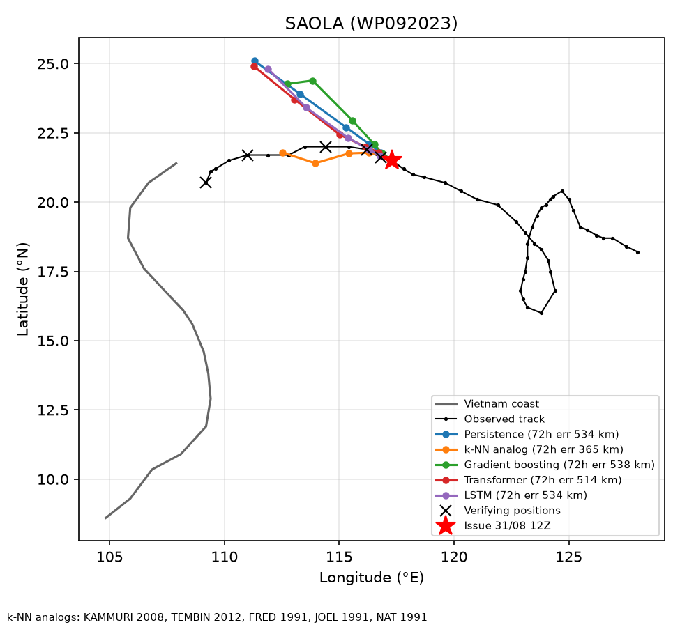
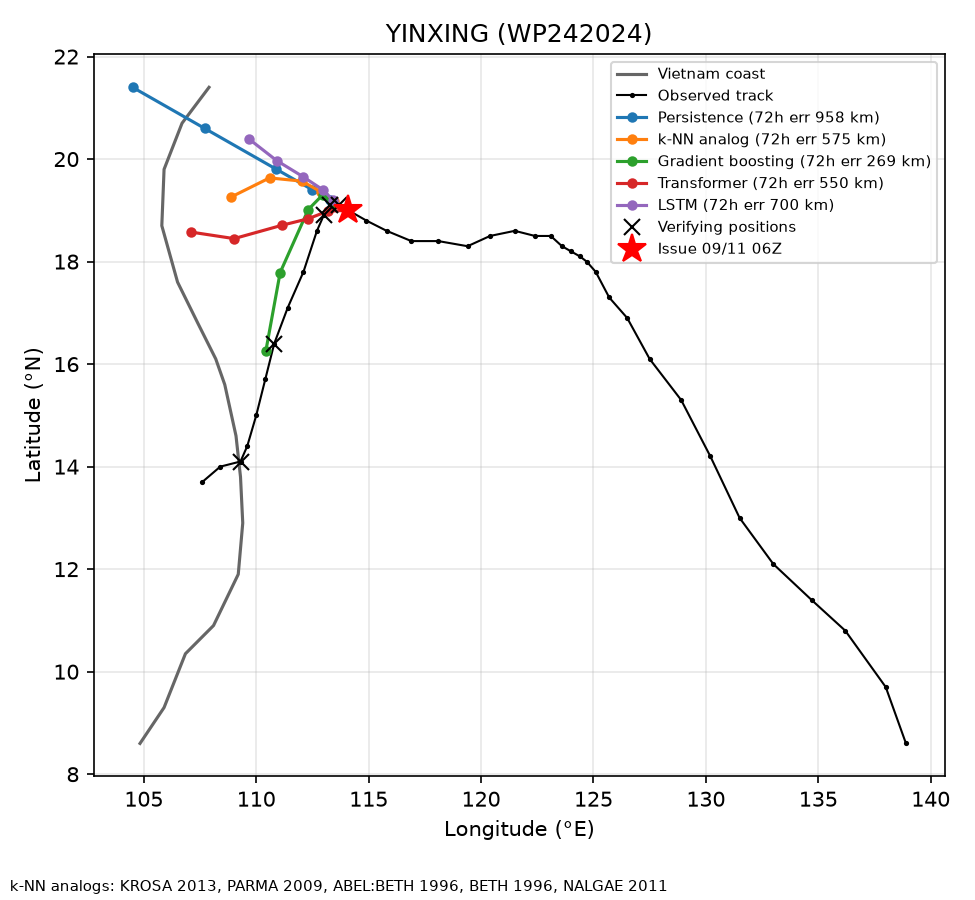
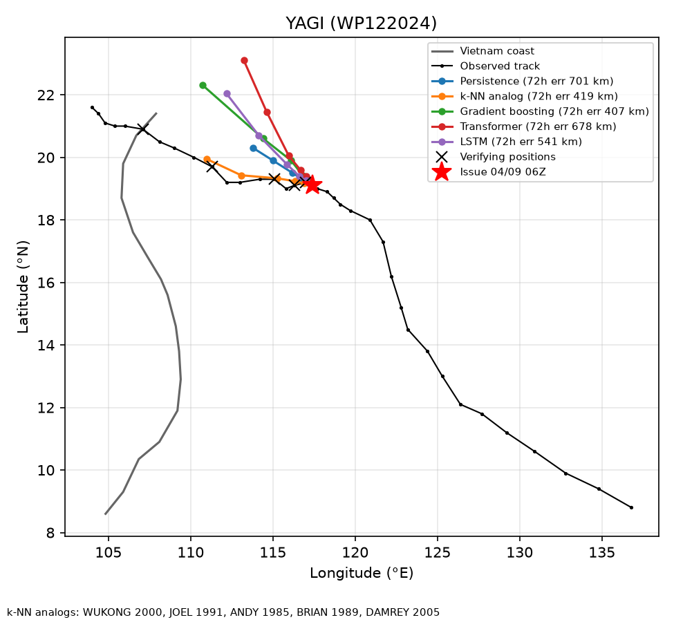
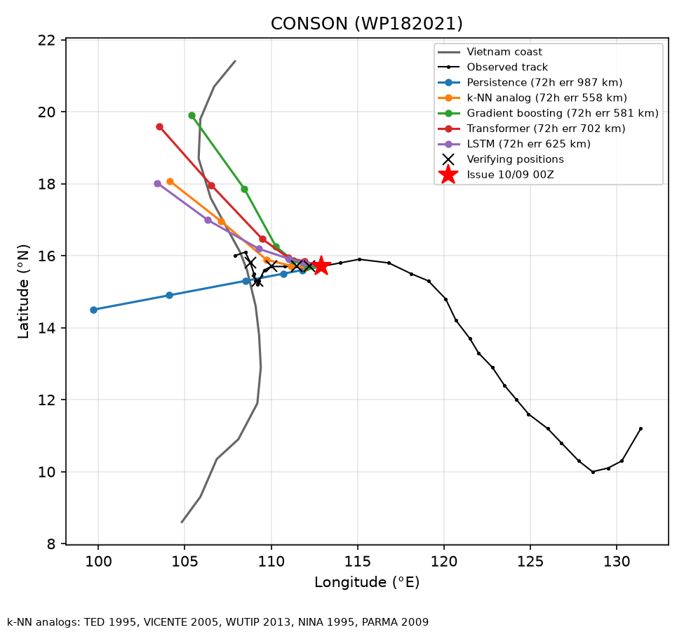

# Case studies: storms affecting Vietnam

## SAOLA (WP092023) — issued 2023-08-31 12Z

| method | 72h error (km) |
|---|---:|
| k-NN analog | 365 |
| Transformer | 514 |
| LSTM | 534 |
| Persistence | 534 |
| Gradient boosting | 538 |
| Attention-LSTM | 579 |
| CLIPER-proxy | 653 |

k-NN analog storms: KAMMURI 2008, TEMBIN 2012, FRED 1991, JOEL 1991, NAT 1991

## YINXING (WP242024) — issued 2024-11-09 06Z

| method | 72h error (km) |
|---|---:|
| Gradient boosting | 269 |
| Transformer | 550 |
| k-NN analog | 575 |
| Attention-LSTM | 621 |
| CLIPER-proxy | 657 |
| LSTM | 700 |
| Persistence | 958 |

k-NN analog storms: KROSA 2013, PARMA 2009, ABEL:BETH 1996, BETH 1996, NALGAE 2011

## YAGI (WP122024) — issued 2024-09-04 06Z

| method | 72h error (km) |
|---|---:|
| Gradient boosting | 407 |
| k-NN analog | 419 |
| LSTM | 541 |
| Attention-LSTM | 622 |
| Transformer | 678 |
| Persistence | 701 |
| CLIPER-proxy | 949 |

k-NN analog storms: WUKONG 2000, JOEL 1991, ANDY 1985, BRIAN 1989, DAMREY 2005

## CONSON (WP182021) — issued 2021-09-10 00Z

| method | 72h error (km) |
|---|---:|
| CLIPER-proxy | 101 |
| Attention-LSTM | 511 |
| k-NN analog | 558 |
| Gradient boosting | 581 |
| LSTM | 625 |
| Transformer | 702 |
| Persistence | 987 |

k-NN analog storms: TED 1995, VICENTE 2005, WUTIP 2013, NINA 1995, PARMA 2009

